<div align="center">



<a href="https://github.com/ssamucr">
  
</a>

<br>

[](https://samu0x.dev)
[](https://www.linkedin.com/in/ssamucr/)
[](mailto:ssamucr@gmail.com)

</div>

<br>

## 👋 Hola

Soy ingeniero de datos en Panamá 🇵🇦. Trabajo en banca, construyendo la plataforma de datos sobre Microsoft Fabric, desde el
lakehouse y los pipelines hasta los modelos de riesgo. Fuera de ahí me engancho con machine learning, agentes y MCP, estudio una
maestría en IA y doy clases de SQL.

Lo que más disfruto es meterme de lleno en un problema real, entenderlo bien y verlo funcionando, ya sea diseñando la
arquitectura, entrenando un modelo o armando la integración que conecta todo.

```python
samuel = {
    "rol":         "Ingeniero de Datos  →  camino a ML Engineer",
    "base":        "Ciudad de Panamá 🇵🇦",
    "trabajo":     "banca: lakehouse, pipelines y modelos de riesgo",
    "estudiando":  "Máster en IA (UNIR), hasta mediados de 2027",
    "enseño":      "SQL para gente que no viene de tecnología",
    "combustible": ["café ☕", "Claude 🤖", "running 🏃"],
    "abierto_a":   "ML e IA, proyectos grandes, remoto internacional",
}
```

<br>

## 🔭 En lo que ando ahora

- 🏦 **Fabric a fondo:** construyendo un lakehouse con modelo estrella y arquitectura medallion que centraliza los datos del banco.
- 🧪 **Modelo de incumplimiento:** comparando regresión logística y árboles (AUC y KS) para predecir mora en préstamos.
- 🤖 **Agentes y MCP:** ya le conecté Claude a Fabric, a Power BI y a mi propia app para hablar con los datos en lenguaje natural.
- 🎓 **Máster en IA:** aprendizaje automático, redes neuronales, NLP, visión artificial e IA generativa.
- 🧑‍🏫 **Clases de SQL:** grupos pequeños y sin tecnicismos.
- 💸 **Eco:** mi app de finanzas personales, que quiero abrir a más gente.

<br>

## 🧰 Con qué trabajo

**Datos y BI**


**IA y ML**


**Desarrollo y nube**


<br>

## 🚀 Algunas cosas que he hecho

| | Proyecto | De qué va |
| :-: | --- | --- |
| 💸 | **Eco** · [backend](https://github.com/ssamucr/eco-app-backend) · [frontend](https://github.com/ssamucr/eco-app-frontend) | Finanzas personales sencillas, con login, API en Python y base en Postgres. Incluye un **MCP remoto** para consultarla y registrar movimientos desde Claude. |
| 🌋 | [**sismos-panama**](https://github.com/ssamucr/sismos-panama) | Resumen analítico de los sismos en Panamá, a raíz del temblor del 9 de octubre. |
| 🧑‍💻 | [**samu0x.dev**](https://github.com/ssamucr/samu0xdev-portfolio) | Mi portafolio, hecho con Astro. |
| 💎 | [**alas-catalog**](https://github.com/ssamucr/alas-catalog) | Catálogo web para un emprendimiento de joyería. |
| 🦠 | [**covid-data-analysis**](https://github.com/ssamucr/covid_data_analysis_visualization) | Análisis y visualización de datos de COVID, de mis tiempos de universidad. |

<br>

## 💬 Pregúntame sobre

`SQL` · `Microsoft Fabric` · `Power BI` · `modelo estrella` · `migrar de QlikView a Fabric` · `MCP con Claude` · `cómo aprender datos con IA`

<br>

## 🌄 Fuera del teclado

🏃 Running, atletismo y gym &nbsp;·&nbsp; ☕ Café de Boquete &nbsp;·&nbsp; 🏞️ Ríos, cascadas y playa &nbsp;·&nbsp; 🎮 Videojuegos
&nbsp;·&nbsp; 🧊 Modelado 3D &nbsp;·&nbsp; 🎬 Series y películas &nbsp;·&nbsp; ✍️ Crear contenido

<br>

<div align="center">

**¿Tienes un proyecto de datos, ML o IA, o quieres conversar de tecnología? Escríbeme, con gusto.**

[](https://www.linkedin.com/in/ssamucr/)

</div>
